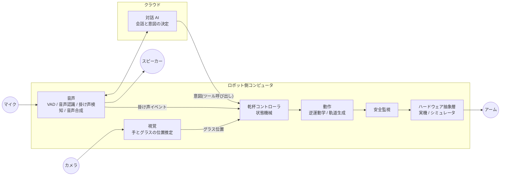
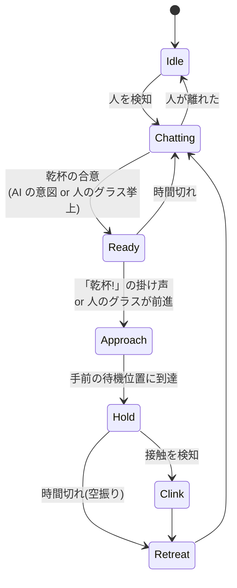

# ソフトウェア構成

## 全体像

処理を「速さが必要なもの」と「賢さが必要なもの」に分け、前者をロボット側、後者をクラウドの AI に置きます。

## モジュール

| モジュール | 責務 | 実行場所 |
| --- | --- | --- |
| `audio` | 発話区間検出、音声認識、「乾杯」の掛け声検知、音声合成 | ロボット側(認識・合成は外部 API も可) |
| `dialogue` | 対話 AI との通信。会話の応答と、乾杯に関する意図の取得 | クラウド |
| `vision` | カメラ画像から人の手・グラスの 3 次元位置を推定 | ロボット側 |
| `toast` | 乾杯の状態機械。各モジュールのイベントを受けて動作を決める | ロボット側 |
| `motion` | 目標位置から関節角を求め、滑らかな軌道を生成 | ロボット側 |
| `safety` | 速度・力・動作範囲の制限、異常時の停止 | ロボット側 |
| `hardware` | サーボ・カメラ・音声入出力の抽象化。実機とシミュレータを差し替え可能にする | ロボット側 |

## AI とロボットの境界

対話 AI には、アームを直接動かす命令ではなく **意図を表す少数のツール** だけを渡します。

| ツール | 意味 |
| --- | --- |
| `propose_toast` | AI から乾杯を誘う。グラスを構える |
| `accept_toast` | 人の誘いに応じる。グラスを構える |
| `decline_toast` | 今は乾杯しない(会話の流れ上、不適切なとき) |
| `express(gesture)` | うなずく、グラスを軽く掲げるなどの身振り |

ツールが呼ばれた後の「いつ・どこへ・どの速さで」は、すべてロボット側の乾杯コントローラが決めます。これにより、通信が遅れても動作のタイミングは崩れず、AI の出力が何であってもアームは安全な範囲でしか動きません。

乾杯の結果(成功、空振り、中断)はコントローラから AI に返し、AI はそれを踏まえて次のひとことを言います。

## 乾杯の状態機械

- **Ready**: グラスを胸の高さに構えて待つ。人のグラスを目で追う。
- **Approach**: 人のグラス位置に向けて差し出す。目標は「人のグラスの数センチ手前」。
- **Hold**: 待機位置でグラスを追従させながら、人が詰めてくるのを待つ。
- **Clink**: サーボの負荷変化、またはマイクの衝撃音で接触を検知。わずかに押し返してから引く。
- どの状態からも、安全監視の異常で即座に停止・脱力に遷移します。

## 遅延予算

人同士の乾杯では、掛け声からグラスが合うまでおおむね 1 秒前後と見込んでいます(要実測)。ロボットが動き出すまでの目標は次のとおりです。

| 区間 | 目標 |
| --- | --- |
| 掛け声の検知(「かんぱ…」の時点で反応) | 300 ms 以内 |
| グラス位置の更新周期 | 30 Hz 以上 |
| 構えから待機位置までの移動 | 0.5〜0.8 秒 |
| 会話の応答(発話終了から返答開始まで) | 1 秒程度 |

掛け声の検知は汎用の音声認識を待たず、専用のキーワード検知で行います。加えて、人のグラスが前に動き出したことを視覚で捉えれば、声より早く反応を始められます。

## グラスの認識

透明なグラスは深度カメラでも画像認識でも捉えにくい対象です。段階的に進めます。

| 段階 | 方法 | 長所 | 短所 |
| --- | --- | --- | --- |
| 1 | グラスに付けたマーカー(ArUco など)を検出 | 確実で位置精度が高い | 専用のグラスが必要 |
| 2 | 手の骨格推定からグラス位置を推定 | 任意のグラスで動く。既存の軽量モデルが使える | 持ち方による誤差 |
| 3 | グラスそのものを検出するモデル | 最も自然 | データ収集と学習が必要 |

最終的な接触は人が詰める設計のため、段階 2 の精度(数センチ)で体験は成立する見込みです。

## 技術選定の方針

- **言語は Python**。視覚・音声・AI のライブラリが揃い、サーボ制御も 30〜100 Hz 程度で足ります。
- **最初は ROS 2 を使わない**。単一プロセス内の非同期処理で始め、モジュール間は明示的なインターフェースで区切ります。構成が大きくなった時点で再検討します。
- **シミュレータを先に作る**。ハードウェア抽象層に仮想アームと仮想の人(グラス位置と掛け声を生成)を実装し、実機なしで状態機械とタイミングを検証できるようにします。
