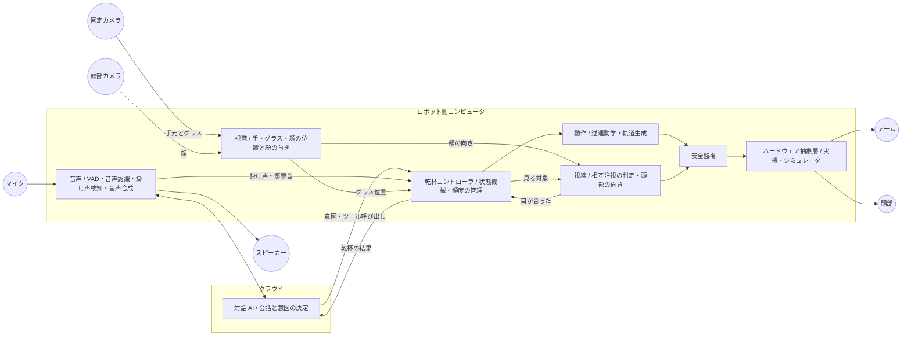
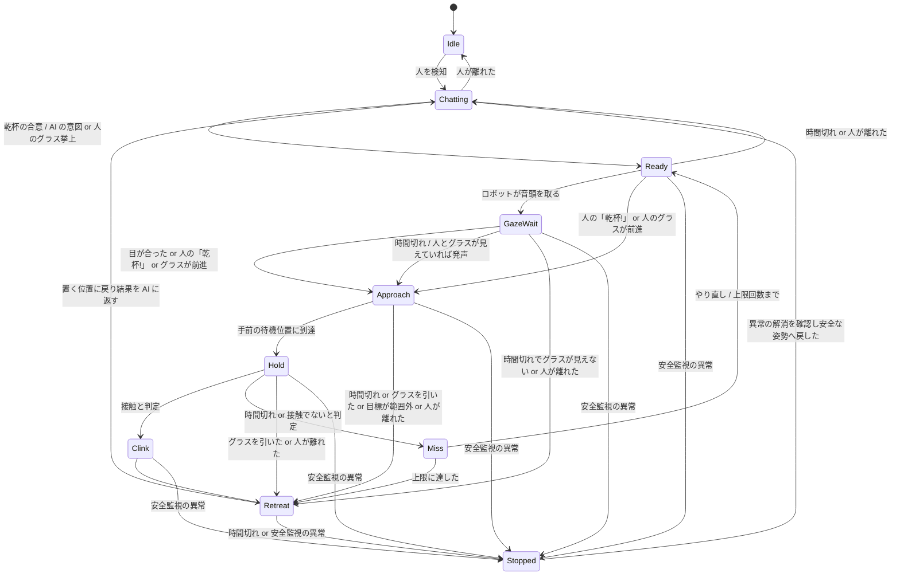

# ソフトウェア構成

## 全体像

処理を「速さが必要なもの」と「賢さが必要なもの」に分け、前者をロボット側、後者をクラウドの AI に置きます。

## モジュール

| モジュール | 責務 | 実行場所 |
| --- | --- | --- |
| `audio` | 発話区間検出(VAD)、音声認識、「乾杯」の掛け声検知、接触の衝撃音の検出、音声合成 | ロボット側(認識・合成は外部 API も可) |
| `dialogue` | 対話 AI との通信。会話の応答と、乾杯に関する意図の取得 | クラウド |
| `vision` | カメラ画像から人の手・グラスの 3 次元位置と、顔の位置・向きを推定 | ロボット側 |
| `gaze` | 人がロボットの頭部を向いているか(相互注視)の判定。頭部を人の顔・グラスへ向ける。1 回の注視時間に上限を設ける | ロボット側 |
| `toast` | 乾杯の状態機械。接触の成否の判定、やり直し、乾杯の頻度の管理 | ロボット側 |
| `motion` | 目標位置から関節角を求め、滑らかな軌道を生成。人のグラスへの追従 | ロボット側 |
| `safety` | アームと頭部の速度・力・動作範囲の制限、異常時の停止 | ロボット側 |
| `hardware` | サーボ・カメラ・音声入出力の抽象化。実機とシミュレータを差し替え可能にする | ロボット側 |

## AI とロボットの境界

対話 AI には、アームを直接動かす命令ではなく **意図を表す少数のツール** だけを渡します。

| ツール | 意味 |
| --- | --- |
| `propose_toast` | AI から乾杯を誘う。会話の節目でだけ使う。頻度の上限に達していればコントローラが見送り、理由を返す |
| `accept_toast` | 人の誘いに応じる。常に受け付ける。前回から短い間隔のときは、コントローラが「ペースが速い」と返し、AI は「ゆっくりいきましょう」と添える |
| `express(gesture)` | うなずく、グラスを軽く掲げるなどの身振り。グラスを口元へ運ぶ身振りは既定では無効(評価実験の比較条件としてだけ有効にできる) |

ロボットから誘うのを見送るときは、AI が `propose_toast` を呼ばないだけです。人の誘いを断るツールは置きません。ツールが呼ばれた後の「いつ・どこへ・どの速さで」と、頭部をどこへ向けるかは、すべてロボット側の乾杯コントローラが決めます。これにより、通信が遅れても動作のタイミングは崩れず、AI の出力が何であってもアームと頭部は安全な範囲でしか動きません。人がいない、グラスが見えないなど安全上の理由でコントローラが動かないときは、結果「中断」を AI に返します。

乾杯の結果(成功、やり直し、空振り、中断、頻度による見送り)はコントローラから AI に返し、AI はそれを踏まえて次のひとことを言います。飲酒を勧める発話をしないことは、AI への指示で定めます([safety.md](safety.md))。

## 乾杯の状態機械

- **Ready**: グラスを胸の高さに掲げて待つ。頭部を人の顔に向け、人のグラスを目で追う。
- **GazeWait**: ロボットから「乾杯!」と言う前に、人がこちらを向くのを待つ。目が合えばすぐ発声して Approach へ進む。待っている間に人が先に「乾杯!」と言うか、グラスを前に出したら、それに合わせて「乾杯!」と返して進む。上限時間を過ぎたら、人が在席でグラスが見えていれば目が合わなくても発声して進み(緩い条件)、そうでなければ発声せずに中断する。人が Ready の時点で先に「乾杯!」と言ったときは、この状態を通らない(暫定、依頼者の確認待ち)。
- **Approach**: 人のグラス位置に向けて差し出す。目標は「人のグラスの数センチ手前」。頭部は人のグラスへ向ける(受け渡しの研究からの類推による仮説。頭部が左右 1 軸の場合は省く)。目標が動作範囲外なら安全監視が拒否し、中断する。
- **Hold**: 待機位置でグラスを追従させながら、人が詰めてくるのを待つ。追従は控えめにする(下記)。
- **接触の判定**: サーボの負荷変化とマイクの衝撃音の両方を使い、片方だけのときは接触でないとみなすか、閾値を変えて判定する(具体的な規則は計測 5 で決める)。先行機(KAIST の飲酒相手ロボット、Jung ら 2023)は加速度センサだけで判定し、誤り率は 5.56% でした。
- **Clink**: 接触の後、押し返しの設定(下記)に従って受け止め、引く。頭部を人の顔に戻す。
- **Miss**: 相手を見て「おっと、もう一回」と短く言い、Ready に戻る。上限に達したら「また後で」と言って引く(上限回数と発話は暫定、依頼者の確認待ち)。
- **Retreat**: グラスを引いて置く位置へ戻す。結果(成功、空振り、中断)を AI に返す。時間内に戻れなければ Stopped に移る。
- **Stopped**: 安全停止。アームと頭部を止めて脱力し、結果「中断」を AI に返す。図では動作中の状態からだけ描いていますが、安全監視の異常ではどの状態からも遷移します。異常が解消したことを確認し、安全な姿勢へ戻してから Chatting に復帰します。

## 調整できるパラメータ

文献で値が決まらない振る舞いは、実行時に切り替えられるパラメータにし、計測実験([roadmap.md](roadmap.md) の計測番号)で決めます。

| パラメータ | 選択肢・初期値 | 決め方 |
| --- | --- | --- |
| 押し返しの強さ | 受け止めるだけ / 弱く押し返す。既定は受け止めるだけ(安全側。暫定、依頼者の確認待ち) | 計測 15 |
| 追従の強さ | 補正なし / 小 / 大。初期値は小 | 計測 8。「動きは早めに始めて意図を読みやすくし、補正は小さく限定的に」は仮説で、「中程度の補正が最適」という根拠はない |
| 相互注視の待ちの上限 | M1 で初期値を仮置きする(文献に根拠となる値はない) | 計測 10 で確定 |
| 1 回の注視時間 | 2 秒程度を既定、3 秒未満を上限(仮置き) | 計測 9。根拠は類推([design-rationale.md](design-rationale.md)) |
| やり直しの上限回数 | 1 回(暫定、依頼者の確認待ち)。コンセプトの「おっと、もう一回」に合わせた値で、文献の根拠はない | 計測 12 |
| 各状態の時間切れ | Ready、Approach、Hold、Retreat の上限時間。Approach は移動の目標(0.5〜0.8 秒)に余裕を持たせる。文献に根拠となる値はなく、M1 で初期値を仮置きする | 計測 1、6、7 と実機の試験 |
| 乾杯の頻度 | [safety.md](safety.md) を参照 | 運用のログ |

## 遅延予算

乾杯で掛け声から接触までの時間を測った研究は見つかっていません。下の表の値はすべて仮置きで、乾杯以外の研究の数値は類推です。確定は計測実験で行います。

| 区間 | 目標(仮置き) | 根拠と確認度 | 確定させる実験 |
| --- | --- | --- | --- |
| 掛け声から接触まで(全体) | 1 秒前後 | 乾杯の実測なし。乾杯以外の到達動作は、座って水入りのコップへ手を伸ばす動作 1.21 秒(健常成人 20 名)、握手で手を伸ばす区間 0.92 秒(開始役 1 名と相手 5 名)(本文確認、類推)。動作が合図の後に始まるなら 1 秒より長くなりうる(推論) | 計測 1 |
| 掛け声の検知(「かんぱ…」の時点で反応) | 300 ms 以内 | 文献なし。工学的な目標 | 計測 1、6 |
| 人の動き出しからロボットの動き出しまで | 0.25 秒程度 | 受け渡しで、反応 0.25 秒が最良、0.03 秒は不快、0.75 秒は温かさが下がった(Pan ら 2019、本文確認、類推)。グラスを合わせる課題で、事前に指示された動作でも、視覚の合図から指をセンサから離すまで約 0.4 秒かかった(Kourtis ら 2014、本文確認。声の合図ではなく、音を消し視線を中央に固定した条件)。ロボットが人より速く反応する必要はないと考えられる(推論) | 計測 6 |
| 構えから待機位置までの移動 | 0.5〜0.8 秒 | 文献なし。上の到達動作の類推値に収まる工学的な目標 | 計測 1、7 |
| グラス位置・顔の向きの更新周期 | 30 Hz 以上 | 文献なし。工学的な目標 | M4 の実機で確認 |
| 会話の応答(発話終了から返答開始まで) | 1 秒程度 | 会話ロボットの応答は 1 秒が最も好まれた(Shiwa ら 2009、要旨確認、類推) | — |
| 接触から補う音の立ち上がりまで(スピーカーで補う場合) | 10 ms 以内、20〜25 ms を上限の目安、音を接触より先に出さない | 打楽器型の電子楽器で、遅延 10 ms は 0 ms と品質評価のほとんどの項目で差がなく、20 ms では評価が下がった(Jack ら 2016、本文確認)ことなどからの推論。類推 | 計測 4 |

掛け声の検知は汎用の音声認識を待たず、専用のキーワード検知で行います。加えて、人のグラスが前に動き出したことを視覚で捉えれば、声より早く反応を始められます。

## グラスの認識

透明なグラスは深度カメラでも画像認識でも捉えにくい対象です。段階的に進めます。

| 段階 | 方法 | 長所 | 短所 |
| --- | --- | --- | --- |
| 1 | グラスに付けたマーカー(ArUco など)を検出 | 確実で位置精度が高い | 専用のグラスが必要 |
| 2 | 手の骨格推定からグラス位置を推定 | 任意のグラスで動く。既存の軽量モデルが使える | 持ち方による誤差 |
| 3 | グラスそのものを検出するモデル | 最も自然 | データ収集と学習が必要 |

最終的な接触は人が詰める設計のため、段階 2 の精度(数センチ)で体験は成立する見込みです。顔の位置と向きは頭部のカメラで推定し、人がロボットの頭部を向いていれば「目が合った」とみなします(ロボットの「skål」の研究でも、人がロボット頭部のカメラの方を向いているかで判定していました)。

## 技術選定の方針

- **言語は Python**。視覚・音声・AI のライブラリが揃い、サーボ制御も 30〜100 Hz 程度で足ります。
- **最初は ROS 2 を使わない**。単一プロセス内の非同期処理で始め、モジュール間は明示的なインターフェースで区切ります。構成が大きくなった時点で再検討します。
- **シミュレータを先に作る**([roadmap.md](roadmap.md) の M1)。ハードウェア抽象層に仮想アーム・仮想の頭部と仮想の人(グラス位置、顔の向き、掛け声を生成)を実装し、実機なしで状態機械とタイミングを検証できるようにします。
- **仮置きの値は設定ファイルに集める**。上の表の値は計測で変わる前提なので、コードに埋め込みません。
