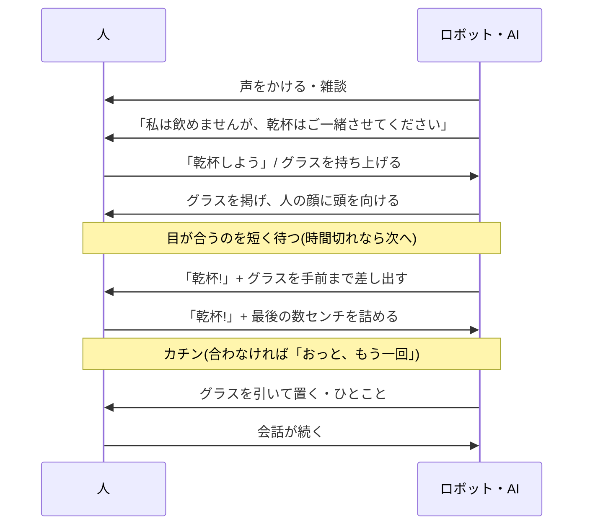

# コンセプト

## なぜ乾杯か

乾杯は、短く、誰でも知っていて、**声・視線・動きのタイミングが揃ったときにだけ成立する** 共同動作です。会話だけでは得られない「同じ場にいる」感覚を、数秒の動作で作れると期待しています。AI に身体を与える最初の一歩として、範囲が小さく、成功・失敗が誰の目にも明らかな題材です。

ただし、乾杯の所作そのものが親しさや信頼を高めることを示した実験は、人同士でもロボット相手でも見つかっていません。「乾杯は、二者が同じ一点へ注意と動作を合わせ、その成功を視線・声・音・手応えで確かめ合う小さな共同行為だから効く」という考えは、隣接分野からの類推による仮説です。このプロジェクトは、人同士の乾杯と同じ効果を約束せず、仮説を確かめながら作ります(根拠の一覧は [design-rationale.md](design-rationale.md))。

## 体験フロー

乾杯は人から始めても、AI から誘ってもよいものとします。ただし AI から誘うのは会話の節目に限り、回数に上限を設けます([safety.md](safety.md))。人が先に「乾杯!」と言ったときは、目が合うのを待たずにすぐ応じます(暫定、依頼者の確認待ち)。

## 設計原則

1. **手順全体を設計の単位にする**(仮説)
   グラスを掲げる、目を合わせる、声を合わせる、グラスを合わせる、引いて置く、までを一続きの手順として作ります。接触だけ、声だけを作り込むことはしません。握手は儀礼として認識されることが効果の条件だと著者が解釈していることなどからの類推で、乾杯で確かめた根拠ではありません。

2. **目が合うのを待ってから声を出す(緩い条件)**
   ロボットから「乾杯!」と言う前に、人がこちらを向くのを短時間待ちます。時間切れなら、目が合わなくても発声して進めます。ロボットの「skål(乾杯)」に対して、目が合っていた人の方がグラスを上げ、言い返すことが多かったという観察(Fischer ら 2020)があります。ただし観察研究で因果は示されておらず、飲む人は増えませんでした。日本人は直視してくる顔をより怒っている・近づきにくいと評価したという比較研究(Akechi ら 2013)もあるため、見つめ続けはしません。

3. **人が最後の数センチを詰める(安全のため)**
   ロボットは人のグラスの手前まで差し出して待ち、最後の接触は人の動きに委ねます。乾杯の接触速度やグラスが割れる速度・力は文献で決まっていないため、接触の速度と力を人が決める方が安全だからです。人が自分で所作を行うと楽しさが増す(Vohs ら 2013)という研究は、要旨しか確認できておらず、一部の実験にデータの来歴の問題が報告されているので、根拠の中心には置きません(詳細は [design-rationale.md](design-rationale.md))。ロボットからも寄せに行く方式は、接触速度の上限を実測で決めた後に検討します。接触の後にわずかに押し返すかどうかは、強さを切り替えられるようにして、計測実験で比べて決めます。

4. **タイミングは現場で、言葉は AI で**
   「乾杯!」への反応は短い時間で求められ、クラウドの AI との往復では間に合わないと判断しています(工学的判断。乾杯での許容時間は文献になく、計測で確かめます)。掛け声の検知、目が合ったかの判定、アームと頭部の動作はロボット側で完結させ、AI は会話の内容と「乾杯に応じる・誘う」といった意図の決定を担います。

5. **失敗しても楽しい**
   空振りや接触の誤検知は必ず起きます(唯一の先行機である KAIST の飲酒相手ロボット、Jung ら 2023 の接触検知でも、誤りは数 % ありました)。グラスが合ったかを判定し、合わなければ相手を見て「おっと、もう一回」と短く言ってやり直します(やり直しの上限回数は暫定)。長く謝るより短く反応して先へ進む方がよいという研究がありますが、乾杯以外の題材からの類推です。

6. **小さく静かに動く**
   動作範囲・速度・力を必要最小限に抑えます。飲み物とグラスのある食卓で動くため、安心感が性能より優先です。

7. **ロボットは飲まない。飲むふりもしない**
   ロボットは飲めないことを自分から伝え、掲げる・目を合わせる・声を合わせる・置くの手順だけを人とそろえます。機械であることを隠さず、飲酒を演出しないためです。ロボットのグラスは当面、空または固定された蓋付きの容器とし、液体をこぼす問題を切り離します。ロボットが複合現実の仮想の食べ物を食べるふりをすると、食事の楽しさと食べた量が増えたという研究(Fujii ら 2020。約 90 秒、台本どおりの会話、片側検定)もあり、この方針には体験の面で代償がありえます。グラスを口元へ運ぶ身振りは、将来の評価実験の比較条件として残します。

## 成功の基準

**体験の流れ**

- 初めての人が説明なしで乾杯できる
- 「乾杯!」の声からグラスが合うまでの流れが、待たされている感じなく進む
- グラスが合ったとき、音が鳴る(当面は樹脂のグラスで、音の質は計測の後に見直す。[hardware.md](hardware.md))
- 乾杯の前後で会話が途切れない
- 空振りしても、やり直しを含めて気まずくならない

**測れる指標**(計測実験と運用のログで追う)

- 相手の応答行動: ロボットの「乾杯!」に対して、グラスを上げる、声を返す
- どれだけ息が合ったと感じたかの自己評定
- 動作ログ上の到達のずれ、接触の成否、空振りとやり直しの回数

人同士の乾杯と同じ効果が得られることは、成功の基準にも説明にも書きません。
