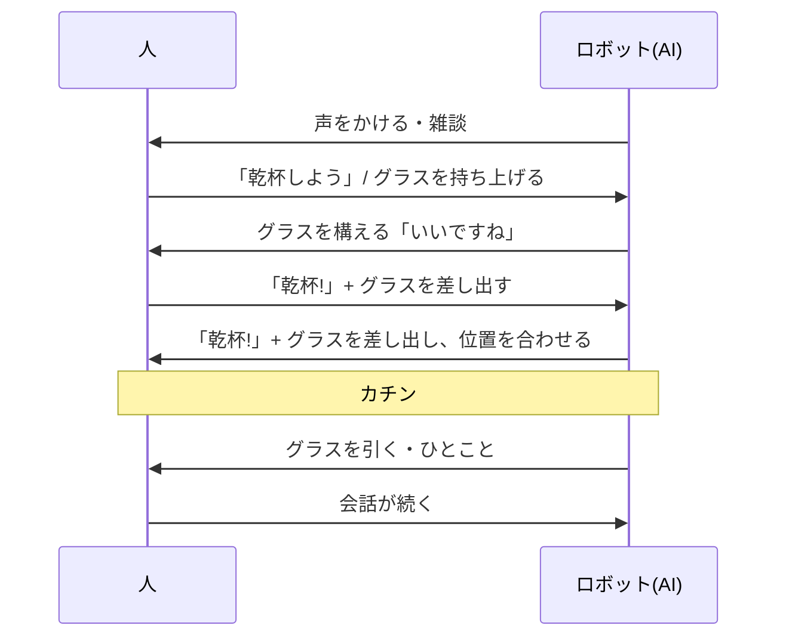

# コンセプト

## なぜ乾杯か

乾杯は、短く、誰でも知っていて、**声・視線・動きのタイミングが揃ったときにだけ成立する** 共同動作です。会話だけでは得られない「同じ場にいる」感覚を、数秒の動作で作れます。AI に身体を与える最初の一歩として、範囲が小さく、成功・失敗が誰の目にも明らかな題材です。

## 体験フロー

乾杯は人から始めても、AI から誘ってもよいものとします。

## 設計原則

1. **人が最後の数センチを詰める**
   ロボットは人のグラスの手前まで差し出して待ち、最後の接触は人の動きに委ねます。人同士の乾杯も互いに歩み寄るものであり、こうすることで接触の速度と力を人が決められ、安全性と自然さの両方が得られます。慣れてきた段階でロボット側からも寄せに行きます。

2. **タイミングは現場で、言葉は AI で**
   「乾杯!」に対する反応は数百ミリ秒の勝負で、クラウドの AI との往復では間に合いません。掛け声の検知とアームの動作はロボット側で完結させ、AI は会話の内容と「乾杯に応じる・誘う」といった意図の決定を担います。

3. **失敗しても楽しい**
   空振りやタイミングのずれは必ず起きます。ずれたら「おっと、もう一回」と言ってやり直せる設計にし、失敗を体験の一部として扱います。

4. **小さく静かに動く**
   動作範囲・速度・力を必要最小限に抑えます。飲み物とグラスのある食卓で動くため、安心感が性能より優先です。

5. **ロボットは飲まない(当面)**
   ロボットのグラスの扱いは未決事項ですが、初期は空、または固定された蓋付きの容器とし、液体をこぼす問題を切り離します。

## 成功の基準

- 初めての人が説明なしで乾杯できる
- 「乾杯!」の声からグラスが合うまでの流れが、待たされている感じなく進む
- グラスが合ったとき、音が鳴る
- 乾杯の前後で会話が途切れない
